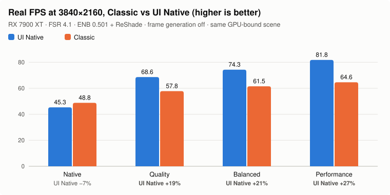

# F4SR

**English** | [简体中文](README_CN.md)

Super resolution and frame generation for Fallout 4, as an F4SE plugin.

F4SR replaces the game's TAA with a modern temporal upscaler and can add generated frames on top:

- **Upscaling:** AMD FSR 3.1, AMD FSR 4.1, or Intel XeSS. Each has four render-resolution presets, from Native (AA only) down to Performance (50%).
- **Frame generation:** XeSS-FG (2X–4X, default) or FSR-FG (2X).
- **ENB compatible.** With XeSS-FG (the default), the game and ENB render at the lower render resolution and the UI is drawn at output resolution ("UI Native"). The older "Classic" pipeline upscales before ENB.
- **ReShade compatible.** Effects can run together with ENB, before upscaling and under the HUD, with the game's depth.
- **Menu-safe.** Terminals, the Pip-Boy, VATS and other menus render correctly at reduced render resolutions.
- **Reactive mask.** Particles, fire, glass and water are not smeared by temporal accumulation.
- **In-game settings** through MCM. Most options apply live.

> Status: **1.1.0-rc.1, the recommended release.** It brings the UI Native pipeline (default), ReShade before upscaling, and the fixes from the 1.1.0 alphas. As a release candidate it becomes 1.1.0 if no new problems turn up. The previous release, 1.0.0-rc.4, stays available under *Old files* on Nexus Mods and as the `v1.0.0-rc.4` release on GitHub. F4SR is developed on Linux; Windows results come from players (see [Tested on](#tested-on)). Bug reports with `f4sr.log` attached are very welcome.

## Requirements

| | |
|---|---|
| Game | Fallout 4 **1.10.163** (the pre-"next-gen" build). Later builds (1.10.984, 1.11.x) are **not** supported. |
| Script extender | [F4SE](https://f4se.silverlock.org/) 0.6.23 |
| Address Library | [Address Library for F4SE Plugins](https://www.nexusmods.com/fallout4/mods/47327) (the 1.10.163 file) |
| MCM (optional) | [Mod Configuration Menu](https://www.nexusmods.com/fallout4/mods/21497), for in-game settings |
| GPU | Any GPU with D3D12 support. FSR 4.1 is heaviest; on RDNA3 it runs as INT8. FSR 3.1 is lightest. |
| OS | Windows 10/11, or Linux with Proton |
| Runtime | [Microsoft Visual C++ v14 Redistributable (x64)](https://learn.microsoft.com/en-us/cpp/windows/latest-supported-vc-redist), current version; in the game's prefix on Proton if missing |

## Installation

1. In MO2, install the ZIP as-is. Its data root already contains `F4SE/` and `MCM/`; Root Builder is not needed. For manual installation, merge those folders into the game's `Data/`.
2. Start the game through F4SE.
3. Open **MCM → F4SR**, or edit `Data/F4SE/Plugins/f4sr.ini`.

When upgrading from an earlier release, replace the old F4SR mod (the file layout is the same since rc.2) and keep `Data/MCM/Settings/f4sr.ini`. Coming from 1.0.0-rc.4, the Render Pipeline option starts at UI Native; choose Classic in MCM for the 1.0 behavior. To go back to 1.0.0-rc.4, install it from *Old files*. Releases since RC2 no longer ship loose `fmt.dll` or `spdlog.dll`; remove RC1 copies next to `Fallout4.exe` only if you know no other plugin uses them.

Disable other upscaler or frame-generation mods for Fallout 4 first. Two plugins hooking the same render path will conflict.

## Settings

The MCM page covers everything most players need:

| Setting | What it does |
|---|---|
| Upscaling | Master switch. |
| Render Pipeline | UI Native (default) or Classic. See [Pipelines](#pipelines). Shown only with XeSS-FG; FSR-FG always uses Classic. Needs a restart. |
| Upscaler | FSR 3.1 / FSR 4.1 / XeSS. |
| Render Resolution | Native (AA only), Quality (67%), Balanced (59%), Performance (50%). Default: Balanced. In UI Native, return to gameplay to apply the preset; unsupported setups require a restart. |
| Sharpening | FSR's RCAS sharpening. Keep it low if ENB already sharpens. |
| Transparency Mask | Reactive mask for transparent effects. Recommended on. Needs a restart. |
| Frame Generation | Master switch. Best on a variable-refresh (FreeSync / G-Sync) display. With XeSS-FG, XeSS-FG loads only if frame generation is on at launch: turning it on in a game that started with it off takes effect after a restart; after that it switches live. |
| Frame Generation Engine | XeSS-FG (default) or FSR-FG. Needs a restart. See [Choosing a frame-generation engine](#choosing-a-frame-generation-engine). |
| XeSS-FG Multiplier | 2X (default) / 3X / 4X. Shown only when XeSS-FG is selected. |
| Low Latency | XeLL (default), AMD Anti-Lag 2 (AMD only, also works with frame generation off; falls back to XeLL when unavailable) or off. Applies live. |
| Async Present | XeSS-FG presents on a worker thread, so the game does not wait for frame pacing. Try it if the GPU clocks down or GPU usage stays low with frame generation on (seen on AMD RX 9000). Off by default. Needs a restart. |
| ReShade Effects Before UI | Renders ReShade effects under the HUD instead of on top of it. In UI Native they run together with ENB, before upscaling. See [ReShade notes](#reshade-notes). |
| ReShade Depth | Gives ReShade the game's depth under XeSS-FG, and in Classic below Native, for ambient occlusion, depth of field, fog and similar effects. On by default. Applies live. |
| Status Panel | Small top-left panel: version and pipeline, FPS (real → shown with frame generation), upscaler and preset, render → output size with the upscaler's GPU time, frame generation, and ReShade mode. Errors are listed at the top in orange; settings changed in MCM that wait for a restart are listed in red under "Restart". The panel also appears on its own for 30 seconds when an error turns a feature off or a change needs a restart. The VRAM row shows the game's video memory use, F4SR's share, and the budget Windows gives the game. |
| Log System Info | On by default. Writes a short system summary at the top of `f4sr.log` for bug reports (see [Log file and privacy](#log-file-and-privacy)). Applies at the next start. |

Precedence: values saved by MCM (`Data/MCM/Settings/f4sr.ini`) override `Data/F4SE/Plugins/f4sr.ini`. The plugin ini also holds a few advanced and troubleshooting keys, and each one is documented in the file.

### Choosing a frame-generation engine

XeSS-FG is the default and the recommended engine. Compared with FSR-FG it gives:

- **Better frame pacing.** Generated frames are spaced evenly. F4SR's FSR-FG path presents each pair in a conservative synchronous mode, which caps the real frame rate at half the refresh rate.
- **Lower input latency,** through Intel XeLL.
- **A cleaner image** with less ghosting around moving objects, thin detail and transparencies.
- **2X to 4X.** FSR-FG is 2X only.

XeSS-FG loads only if frame generation is on at launch. A game started with frame generation off does not load it, which saves about 1 GB of VRAM at 4K output; turning frame generation on then needs one restart. Once loaded, frame generation and its multiplier switch live. This holds for both pipelines.

FSR-FG stays available as a fallback, for example if XeSS-FG does not start on your system (the status panel and `f4sr.log` say why). FSR-FG always uses the Classic pipeline.

### Choosing a frame-generation multiplier

Pick the multiplier where *real FPS × multiplier* is close to your refresh rate. Going higher adds latency without adding visible frames. On a 165 Hz display, for example, 41 real FPS suits 4X and 55 real FPS suits 3X.

Fixed-refresh displays work too. A player on a 50 Hz TV reports XeSS-FG running well there, where other frame-generation mods did not; 2X from 25 real FPS fills 50 Hz.

## Pipelines

### UI Native (default with XeSS-FG)

- The game and ENB render at the render resolution. F4SR upscales the finished frame, then the game draws the UI on it at output resolution. ENB's settings overlay and late `Present` effects are carried onto the output.
- Below Native it is faster than Classic, because ENB and ReShade also run at the render resolution. Measured on an RX 7900 XT at 3840×2160 output, FSR 4.1, ENB 0.501 and ReShade, frame generation off: Quality 68.6 vs 57.8 FPS, Balanced 74.3 vs 61.5, Performance 81.8 vs 64.6. At Native, Classic is slightly faster (48.8 vs 45.3 FPS).

  <picture>
    <source media="(prefers-color-scheme: dark)" srcset="docs/images/perf-4k-dark.svg">
    
  </picture>

- ENB's sharpening and edge effects run before upscaling, so the fine-edge shimmer that Classic can show at reduced render resolutions does not appear.
- Upscalers: FSR 3.1, FSR 4.1 and XeSS-SR. Frame generation can be on or off.
- **Change Render Resolution in MCM, then close the menu and return to gameplay.** In windowed/borderless mode, with ENB 0.501-compatible swap chains or without ENB, the game (and ENB) rebuild their buffers without restarting. Expect a brief pause and a few seconds while upscaling and frame generation recover. If the status panel asks for a restart, quit to desktop and relaunch through F4SE; reloading a save is not enough.
- With 3840×2160 output, the internal resolutions are Quality **2560×1440**, Balanced **2258×1270**, and Performance **1920×1080**; Native renders at **3840×2160** and uses the selected upscaler for anti-aliasing. Keep `iSize W` and `iSize H` in `Fallout4Prefs.ini` at your output resolution.
- `bPathBNonLinearColor` (plugin ini, on by default) tells the upscaler that the frame it reads is gamma-encoded, as SDR output with or without ENB is. Turn it off only for a preset that outputs linear color.
- Exclusive fullscreen (`bFull Screen=1`) runs as borderless fullscreen, since the frame is presented through F4SR's own swap chain on the game window.
- **Fallback:** if UI Native cannot start (for example, XeSS-FG cannot take over the swap chain), F4SR uses Classic for that session, switches the MCM choice to Classic and shows an error on the status panel. Select UI Native again in MCM to retry after fixing the cause.

### ENB presets in UI Native

ENB now runs before the upscaler, on the render-resolution frame. Most presets look the same; a few things behave differently:

- **ENB's own temporal anti-aliasing** (TAA in the preset's prepass or postpass shaders) now sees the upscaler's sub-pixel camera jitter and can blur or ghost. Turn it off; the upscaler already anti-aliases.
- **Effects sized in pixels** (sharpening radius, film grain, noise, some lens effects) are drawn at the render resolution and then upscaled, so they appear larger by the same factor as ReShade effects (see the table under [ReShade notes](#before-ui-with-ui-native)). Grain and noise may also look softer or shimmer slightly after upscaling.
- Tested with ENB 0.501. Other versions should work, but if the image looks wrong (offset, wrong size, flickering, ENB's menu not clickable), switch Render Pipeline to Classic and report it with `f4sr.log` and your ENB version.
- Without ENB, UI Native works the same way, including switching Render Resolution live.

### Classic

- Used with FSR-FG, or when chosen in MCM. F4SR upscales before ENB; ENB's post-processing runs on the upscaled image at output resolution.
- **Lower render resolutions with ENB** (Quality, Balanced, Performance): F4SR adjusts some of ENB's own draws to the lower resolution. It finds them by their code pattern: they are found in ENB 0.420, 0.496 and 0.501 (tested in game: 0.501), and not in 0.307 or older. If they are not found, F4SR stays at native resolution (anti-aliasing only, no FPS gain), and the status panel and `f4sr.log` say so. If the image looks wrong instead (shifted, shrunk into a corner, flickering), set Render Resolution to Native (AA only) and report it with `f4sr.log` and your ENB version.
- Effects that depend on scene depth get a depth buffer remapped to the output resolution.
- At reduced render resolutions, ENB's own sharpening can make fine edges shimmer slightly. Lower ENB's sharpening, or set F4SR's Sharpening to 0, if this bothers you.

## ReShade notes

- ReShade works alongside ENB (ENB as `d3d11.dll`, ReShade as `dxgi.dll`). **ReShade Effects Before UI** and **ReShade Depth** need the ReShade build with add-on support.
- **Without Before UI**, ReShade's effects run on the output after the UI, once per shown frame (generated frames included). Their GPU cost grows with the frame-generation multiplier.

### Before UI with UI Native

- The effects run on the render-resolution frame right after ENB, before upscaling. The HUD is untouched, the upscaler anti-aliases the result, and generated frames interpolate the effects instead of re-running them. They also cost less, since they run at the render resolution.
- Depth is this frame's depth at the same resolution, so depth-based effects line up exactly.
- **Effects sized in pixels appear larger**, because they are drawn at the render resolution and then upscaled: overlays and layers (Layer), borders, ASCII, CRT lines, film grain. The factor depends on the Render Resolution preset:

  | Preset | Render scale | Pixel-sized effects appear | Multiply their size by |
  |---|---|---|---|
  | Native | 100% | ×1.00 | 1.00 |
  | Quality | 67% | ×1.50 | 0.67 |
  | Balanced | 59% | ×1.70 | 0.59 |
  | Performance | 50% | ×2.00 | 0.50 |

  For example, with Balanced set Layer's `Layer_Scale` to 0.59 of its usual value. Readjust after changing the preset. The status panel and `f4sr.log` show the current factor. If you need pixel-exact overlays, turn Before UI off.
- Changing the preset, or turning Before UI on or off, makes ReShade reload its effects at the new size (a short pause). Settings in the ReShade overlay apply live as usual.
- Screen-fixed effects (vignette, grain, borders) pass through the upscaler. In testing they stayed clean; report any that smear.

### Before UI with Classic

- With FSR-FG or frame generation off, the effects run after upscaling and ENB, before the HUD. With frame generation on, screen-fixed effects can trail during motion.
- With XeSS-FG on Classic, Before UI is not available; the effects stay on top of the HUD. Use UI Native.

### Limits under XeSS-FG

- ReShade's instance on the game's own swap chain never presents. Add-ons that act on the game's draws or choose when effects render (ReShade Effect Shader Toggler, REST) have no effect. **ReShade Depth** supplies depth instead of ReShade's own depth detection.
- **Before UI** replaces add-ons such as ReShade Effect Shader Toggler for keeping effects off the HUD. Disable those.
- Without Before UI, depth-based effects use the last real frame's depth on generated frames, so they can lag slightly behind fast motion.

## High FPS Physics Fix

High FPS Physics Fix (HFPF) can change the game's resolution and swap chain. With F4SR, use these values in the `[Display]` section of `Data/F4SE/Plugins/HighFPSPhysicsFix.ini`:

```ini
BorderlessUpscale=true
ResizeBuffersDisable=false
```

Leave the other `[Display]` keys at their defaults; in particular, keep `Resolution` and `ResolutionScale` commented out.

- If a mod hands the game your monitor resolution, F4SR sets it back to the Render Resolution and the status panel says "another mod changed the game resolution".
- If the game still renders at monitor size, the panel shows "Render Resolution ignored: game runs at monitor size". The upscaler then works as native AA and FPS does not improve. Check the `[Display]` section above.
- With `ResizeBuffersDisable=true`, Render Resolution changes in MCM take effect after a game restart; the panel says so.

`f4sr.log` records the HFPF `[Display]` values at startup.

## Known issues

- Only Fallout 4 1.10.163 is supported.
- Classic only: fine-edge shimmer at reduced render resolutions with ENB sharpening, as described under [Classic](#classic).
- VATS was checked less thoroughly at reduced render resolutions than other menus. If a translucent rectangle appears in the top-left corner of the screen, please report which menu showed it.
- Windows with display scaling (DPI) above 100% has not been confirmed yet.
- Frame generation adds input latency, as all frame generation does.

## Troubleshooting

- **Log file:** `Documents/My Games/Fallout4/F4SE/f4sr.log`. Attach it to any bug report. It is rewritten on every launch, so copy it right after the session that showed the problem.
- **Ghosting or double images:** turn on *Force History Reset* in MCM. If the ghosting disappears, the problem is in the motion vectors. Please report it with the log.
- **Nothing happens:** check the log for `frame pipeline ready`. Check that F4SE and the Address Library match the 1.10.163 build.
- **Status panel shows "not running" under Upscale:** the upscaler is not running. The log names the reason.

### Log file and privacy

Since 1.1.0-rc.1, `f4sr.log` starts with a short system summary so that a shared log answers the usual first questions:

- F4SR, game and F4SE versions;
- Windows version (or the Wine/Proton version and host system);
- CPU model, core count and RAM size;
- each GPU with its vendor/device ID, VRAM and driver version;
- each display's resolution, refresh rate and HDR state;
- the display keys of `Fallout4Prefs.ini`;
- proxy DLLs next to `Fallout4.exe` (ENB, ReShade and similar) with their versions, and the `[Display]` section of `HighFPSPhysicsFix.ini`;
- the main F4SR settings.

The log is written only to your own disk; F4SR sends nothing anywhere. Your user name and computer name are not recorded, and folder paths in every log line are shortened: the game folder becomes `<game>`, your profile and Documents folders become `<profile>` and `<documents>`, and any other `\Users\<name>\` path shows `<user>`. To leave the system summary out, turn off **MCM → F4SR → Diagnostics → Log System Info** (or set `bLogSystemInfo=0` in `Data/F4SE/Plugins/f4sr.ini`); it applies at the next start.

## Tested on

- Fallout 4 1.10.163, F4SE 0.6.23, with ENB, on:
  - AMD Radeon RX 7900 XT, 3840×2160 at 165 Hz, VRR, Linux (Proton, gamescope); with and without ReShade.
  - AMD Radeon RX 7600, Windows (user report, 1.0.0-rc builds).
  - NVIDIA GeForce RTX 4060, 3840×2160, Windows, XeSS-FG, 50 Hz TV (user report, 1.1.0-alpha.2).
  - 3440×1440, Windows, Fallout: London (user report, 1.1.0-alpha.2).

On Windows, 1.1.0-alpha.1 made the game window smaller on every launch (it saved a reduced resolution to `Fallout4Prefs.ini`); later builds fix this. If you ran alpha.1, set `iSize W` and `iSize H` in `Documents\My Games\Fallout4\Fallout4Prefs.ini` back to your resolution once.

Reports from Intel GPUs, other resolutions and Windows display scaling above 100% are especially welcome.

## Building

- **Toolchain:** clang-cl and lld-link with the MSVC CRT and Windows SDK, plus vcpkg (`x64-windows-clang-staticdeps` for release packages: static fmt/spdlog, dynamic CRT). Packaging needs `llvm-readobj`, `zip`, and `unzip`.
- **Dependencies:** CommonLibF4 under `third_party/`, with the FidelityFX and XeSS SDKs under `sdk/`.
- **Commands:**
  ```sh
  tools/build-f4sr.sh --staticdeps
  tools/package.sh build-sf dist/f4sr-v1.1.0-rc.1.zip
  ```

## Credits

- [Community Shaders](https://github.com/doodlum/skyrim-community-shaders) and doodlum's Fallout 4 work. F4SR's render-resolution proxy targets and several hook anchors are ported from them.
- CommonLibF4 and the F4SE team.
- AMD FidelityFX SDK (FSR 3.1, FSR 4.1, FSR frame generation).
- Intel XeSS SDK (XeSS super resolution, XeSS frame generation, XeLL).

## License

F4SR is licensed under the **GNU General Public License v3.0** (see [LICENSE](LICENSE)).

Third-party components ship under their own licenses, reproduced in `licenses/`:

- AMD FidelityFX SDK runtime DLLs: AMD license (binary redistribution, no modification).
- Intel XeSS SDK DLLs: Intel Simplified Software License (binary redistribution, no modification).
- fmt and spdlog: MIT.
- AMD Anti-Lag 2 SDK header (compiled in, Low Latency option): MIT.
