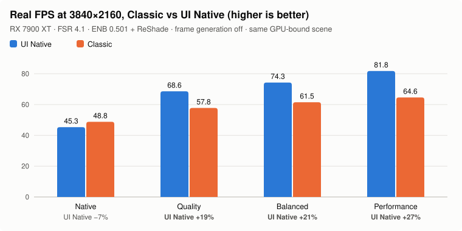

# F4SR

[English](README.md) | **简体中文**

为《辐射 4》提供超分辨率与帧生成的 F4SE 插件。

F4SR 用现代时域超分替换游戏自带的 TAA，并可在此之上叠加生成帧：

- **超分：** AMD FSR 3.1、AMD FSR 4.1 或 Intel XeSS。每种都有四档渲染分辨率预设，从原生（仅抗锯齿）到性能（50%）。
- **帧生成：** XeSS-FG（2X–4X，默认）或 FSR-FG（2X）。
- **兼容 ENB。** 画面在 ENB 后处理之前完成超分，ENB 仍在完整输出分辨率下运行。
- **兼容 ReShade**，并可选择让 ReShade 效果画在 HUD 之前。
- **菜单安全。** 终端、哔哔小子、VATS 等菜单在降低渲染分辨率时也能正确显示。
- **反应遮罩（Reactive mask）。** 粒子、火焰、玻璃和水面不会被时域累积涂抹。
- **游戏内设置** 通过 MCM 调整，多数选项即时生效。

> 状态：**发布候选（release candidate）**。目前只在少数配置上测试过（见[测试环境](#测试环境)）。欢迎附带 `f4sr.log` 提交 bug 报告。

## 两个版本：推荐实验版

F4SR 有两个构建：

- **实验版 — [v1.1.0-alpha.1](https://github.com/carrotciallo/f4sr/releases/tag/v1.1.0-alpha.1)**（预发布；源码在 [`experimental`](https://github.com/carrotciallo/f4sr/tree/experimental) 分支）。**推荐使用这个版本。** 它新增了 **UI Native** 管线：游戏、ENB 与 ReShade 全部在渲染分辨率下运行，完成的画面再被超分，UI 最后以完整输出分辨率绘制。在原生以下的档位，它比稳定版又快又干净——ENB 与 ReShade 随游戏一起变便宜，且 ENB 自带锐化在低渲染分辨率下可能出现的细边缘闪烁也消失了，因为 ENB 的效果会随画面一起被超分。UI Native 下还可以在游戏内实时切换渲染分辨率。
- **稳定版 — v1.0.0-rc.4**（本分支）。只有 Classic 管线：超分在 ENB 后处理之前完成，ENB 仍在完整输出分辨率下运行。如果实验版与你的 ENB 版本或预设配合不佳，保留这个版本，并请附带 `f4sr.log` 反馈。

| | 稳定版 v1.0.0-rc.4 | 实验版 v1.1.0-alpha.1 |
|---|---|---|
| 管线 | Classic | UI Native（默认）＋ Classic |
| ENB 与 ReShade | 在输出分辨率运行，位于超分之后 | 在渲染分辨率运行，位于超分之前 |
| 低分辨率下 ENB 边缘闪烁 | 可能出现 | 没有——ENB 效果随画面一起超分 |
| 帧生成 | XeSS-FG（2X–4X，默认）或 FSR-FG（2X） | 引擎相同；XeSS-FG 走 UI Native，FSR-FG 始终走 Classic |

### 性能

在 RX 7900 XT 上实测：3840×2160 输出、FSR 4.1、ENB 0.501 加载预设并启用 ReShade、帧生成关闭（真实 FPS）：

| 渲染分辨率 | UI Native（实验版） | Classic（稳定版） |
|---|---|---|
| 原生 — 3840×2160 | 45.3 | 48.8 |
| 质量 — 2560×1440 | 68.6 | 57.8 |
| 平衡 — 2258×1270 | 74.3 | 61.5 |
| 性能 — 1920×1080 | 81.8 | 64.6 |

<picture>
  <source media="(prefers-color-scheme: dark)" srcset="docs/images/perf-4k-dark.svg">
  
</picture>

原生档下 Classic 略快——100% 渲染比例时超分无从获益。在其余每个降档上实验版都领先，因为 ENB 与 ReShade 随游戏一起变便宜了。


## 环境要求

| | |
|---|---|
| 游戏 | 《辐射 4》**1.10.163**（"次世代"更新之前的版本）。更高版本（1.10.984、1.11.x）**不受支持**。 |
| 脚本扩展 | [F4SE](https://f4se.silverlock.org/) 0.6.23 |
| 地址库 | [Address Library for F4SE Plugins](https://www.nexusmods.com/fallout4/mods/47327)（1.10.163 对应文件） |
| MCM（可选） | [Mod Configuration Menu](https://www.nexusmods.com/fallout4/mods/21497)，用于游戏内设置 |
| GPU | 任何支持 D3D12 的 GPU。FSR 4.1 负载最高，在 RDNA3 上以 INT8 方式运行；FSR 3.1 最轻。 |
| 系统 | Windows 10/11，或 Linux + Proton |
| 运行库 | 最新的 [Microsoft Visual C++ v14 Redistributable（x64）](https://learn.microsoft.com/en-us/cpp/windows/latest-supported-vc-redist)；若 Proton 环境缺少运行库，装入游戏自己的 prefix |

## 安装

1. 在 MO2 中直接安装 ZIP。包根已包含 `F4SE/` 和 `MCM/`，无需 Root Builder。手动安装时，把这两个文件夹合并到游戏的 `Data/`。
2. 通过 F4SE 启动游戏。
3. 打开 **MCM → F4SR**，或编辑 `Data/F4SE/Plugins/f4sr.ini`。

从 RC1 升级时，替换旧 F4SR 模组，保留 `Data/MCM/Settings/f4sr.ini`。新版不再附带散装 `fmt.dll` 或 `spdlog.dll`。仅当确认 `Fallout4.exe` 旁的文件来自 RC1、且没有其他插件使用时，再清理它们。

先禁用其他《辐射 4》超分或帧生成模组。两个插件挂同一条渲染路径会冲突。

## 设置

MCM 页面覆盖了大多数玩家需要的选项：

| 设置 | 作用 |
|---|---|
| 超分 | 总开关。 |
| 超分引擎 | FSR 3.1 / FSR 4.1 / XeSS。 |
| 渲染分辨率 | 原生（仅抗锯齿）、质量（67%）、平衡（59%）、性能（50%）。使用 ENB 时见 [ENB 说明](#enb-说明)。 |
| 锐化 | FSR 的 RCAS 锐化。若 ENB 已做锐化，请调低。 |
| 透明反应遮罩 | 针对透明特效的反应遮罩，建议开启。需要重启。 |
| 帧生成 | 总开关。在可变刷新率（FreeSync / G-Sync）显示器上效果最好。使用 XeSS-FG 时，第一次开启需要重启游戏才生效，之后可即时开关。 |
| 帧生成引擎 | XeSS-FG（默认）或 FSR-FG。需要重启。见[如何选帧生成引擎](#如何选帧生成引擎)。 |
| XeSS-FG 倍率 | 2X（默认）/ 3X / 4X。仅在选择 XeSS-FG 时显示。 |
| ReShade 效果画在 UI 之前 | 让 ReShade 效果画在 HUD 之前，而不是盖在 HUD 上。见 [ReShade 说明](#reshade-说明)。 |
| 状态面板 | 左上角小面板，显示：超分引擎、渲染 → 输出尺寸、超分 GPU 耗时、遮罩状态、帧生成真实 → 显示帧率。 |

优先级：MCM 保存的值（`Data/MCM/Settings/f4sr.ini`）覆盖 `Data/F4SE/Plugins/f4sr.ini`。插件 ini 里还有少数高级与排障选项，每项都在文件内有说明。

### 如何选帧生成引擎

XeSS-FG 是默认引擎，也是推荐的引擎。与 FSR-FG 相比：

- **帧间隔更均匀。** 生成帧的间隔更平稳。F4SR 的 FSR-FG 以保守的同步模式提交每对帧，真实帧率上限为刷新率的一半。
- **输入延迟更低**，得益于 Intel XeLL。
- **画面更干净**，运动物体、细小细节和透明物周围的拖影更少。
- **支持 2X 到 4X。** FSR-FG 只有 2X。

XeSS-FG 需要在游戏启动时接管交换链，因此只在启动时帧生成已开启的情况下才会接管。从不开帧生成的玩家，游戏的交换链保持原样。如果在游戏运行中才开启帧生成，需要重启一次，之后即可即时开关。

FSR-FG 作为备用方案保留，例如 XeSS-FG 在你的系统上无法启动时（状态面板和 `f4sr.log` 会写明原因）。

### 如何选帧生成倍率

选择让 *真实帧率 × 倍率* 接近显示器刷新率的倍率。再往上只会增加延迟，不会增加可见帧。例如在 165 Hz 显示器上，41 的真实帧率适合 4X，55 适合 3X。

## ENB 说明

- **ENB 下的较低渲染分辨率**（质量、平衡、性能）：F4SR 需要把 ENB 自身的部分绘制调整到较低分辨率。这些绘制按代码特征查找：在 ENB 0.420、0.496 和 0.501 中都能找到（游戏内实测为 0.501），0.307 及更早版本中找不到。找不到时，F4SR 保持原生分辨率（仅抗锯齿，不提升帧率），状态面板和 `f4sr.log` 会写明原因。如果画面反而异常（错位、缩在角落、闪烁），请把渲染分辨率调回原生（仅抗锯齿），并附上 `f4sr.log` 和你的 ENB 版本报告。
- ENB 的后处理在超分后的画面上运行。依赖场景深度的效果会拿到一份重映射到输出分辨率的深度缓冲。
- 在较低渲染分辨率下，ENB 自带的锐化可能让细边缘轻微闪烁。若介意，可调低 ENB 锐化，或把 F4SR 的锐化设为 0。

## ReShade 说明

- ReShade 可与 ENB 共存（ENB 为 `d3d11.dll`，ReShade 为 `dxgi.dll`）。开启帧生成时，两种引擎下 ReShade 效果都会作用于每一帧显示的画面，包括生成帧。
- **ReShade 效果画在 UI 之前** 需要带 add-on 支持的 ReShade 版本。开启后，F4SR 会在超分和 ENB 之后、HUD 之前渲染 ReShade 效果，HUD 不受影响，帧生成会把效果和场景一起插值。该选项适用于 FSR-FG 和不开帧生成的情况；使用 XeSS-FG 时，效果暂时仍盖在 HUD 之上。
- 开启该选项并开启帧生成时，固定在屏幕上的效果（边框、贴图叠加、暗角、颗粒）在运动时可能拖影。如果依赖这类效果，请关闭该选项。
- 该选项可以取代 ReShade Effect Shader Toggler 等插件的同类用途。请停用这类插件，两个插件同时决定效果的渲染时机会冲突。

## 已知问题

- 仅支持《辐射 4》1.10.163。
- 如 ENB 说明所述，低渲染分辨率加 ENB 锐化时细边缘闪烁。
- 除终端外的菜单在低渲染分辨率下检查得较少：动力装甲 HUD、工作台和 VATS。若屏幕左上角出现半透明矩形，请报告是哪个菜单。
- 帧生成会增加输入延迟，所有帧生成技术都如此。

## 排障

- **日志文件：** `Documents/My Games/Fallout4/F4SE/f4sr.log`。提交 bug 报告时请附带。
- **重影或双影：** 在 MCM 里开启 *Force History Reset*。若重影消失，问题出在运动矢量上。请附日志报告。
- **完全没效果：** 在日志里找 `frame pipeline ready`。确认 F4SE 和地址库与 1.10.163 版本匹配。
- **状态面板显示 "not dispatching"：** 超分没有在运行，日志里写了原因。

## 测试环境

- 《辐射 4》1.10.163，F4SE 0.6.23，装有 ENB，在以下环境：
  - AMD Radeon RX 7900 XT，3840×2160 @ 165 Hz，VRR，Linux（Proton、gamescope）；有无 ReShade 均测试过。
  - AMD Radeon RX 7600，Windows（用户报告）。

特别欢迎来自 NVIDIA 与 Intel GPU 以及其他分辨率的报告。XeSS-FG 尚未在 NVIDIA GPU 上测试过。

## 构建

- **工具链：** clang-cl 与 lld-link，配合 MSVC CRT、Windows SDK 和 vcpkg（发行包使用 `x64-windows-clang-staticdeps`：静态链接 fmt/spdlog，保留动态 CRT）。打包需要 `llvm-readobj`、`zip` 和 `unzip`。
- **依赖：** `third_party/` 下的 CommonLibF4，以及 `sdk/` 下的 FidelityFX SDK、XeSS SDK。
- **命令：**
  ```sh
  tools/build-f4sr.sh --staticdeps
  tools/package.sh build-sf dist/f4sr-v1.0.0-rc.4.zip
  ```

## 致谢

- [Community Shaders](https://github.com/doodlum/skyrim-community-shaders) 与 doodlum 的《辐射 4》工作。F4SR 的渲染分辨率代理目标与若干钩子锚点移植自该项目。
- CommonLibF4 与 F4SE 团队。
- AMD FidelityFX SDK（FSR 3.1、FSR 4.1、FSR 帧生成）。
- Intel XeSS SDK（XeSS 超分、XeSS 帧生成、XeLL）。

## 许可证

F4SR 本体采用 **GNU 通用公共许可证 v3.0**（见 [LICENSE](LICENSE)）。

第三方组件按各自许可证随包分发，全文见 `licenses/`：

- AMD FidelityFX SDK 运行时 DLL：AMD 许可证（二进制再分发，禁止修改）。
- Intel XeSS SDK DLL：Intel 简化软件许可证（二进制再分发，禁止修改）。
- fmt 与 spdlog：MIT。
